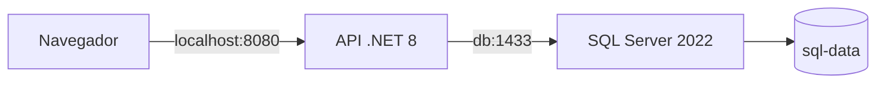

# Greenhouse API — documentação técnica

## Integrantes

| Integrante | RM |
|---|---|
| Mateus Durães dos Santos | 565195 |
| Gabrielle Correa Leme | 561176 |
| Jonatas Henrique da Silva Capelati | 565732 |
| Vinicius Tarifa Fabiano | 565314 |
| Israel da Silva Capelati | 565730 |

## Projeto e tecnologias

API para cadastro e gestão de estufas, sensores e alertas. Usa ASP.NET Core/.NET 8, Entity Framework Core, SQL Server 2022, JWT e Swagger. Docker Compose executa o ambiente local; GitHub Actions entrega a aplicação em Azure App Service.

O escopo atual não inclui frontend, conexão com sensores reais, ingestão de leituras ambientais ou resolução de alertas.

## Pipeline e lógica dos ambientes

O arquivo `.github/workflows/azure-webapps-dotnet-core.yml` é acionado por push nas branches `dev` e `main`, incluindo pushes resultantes de merges. Também permite execução manual.

1. Checkout e configuração do SDK .NET 8.
2. Restore do projeto de testes e de sua referência à API.
3. Build Release dos testes e da API.
4. Execução de testes xUnit e confirmação de que o relatório TRX registra testes executados.
5. Upload do relatório de testes, inclusive se houver falha.
6. Build Docker para validar a imagem.
7. Publish da API, identificação do ambiente e upload do pacote.
8. Download do pacote pelo job de deploy e publicação no App Service correspondente.

| Branch | Condição do job | App Service | Secret |
|---|---|---|---|
| `dev` | `github.ref == 'refs/heads/dev'` | `greenhouse-staging` | `AZURE_WEBAPP_PUBLISH_PROFILE_STAGING` |
| `main` | `github.ref == 'refs/heads/main'` | `greenhouse-production` | `AZURE_WEBAPP_PUBLISH_PROFILE_PRODUCTION` |

Os dois deploys dependem somente do build. Produção não passa por staging. Falhas em restore, build, testes, validação da imagem ou publish impedem o deploy.

O workflow deve existir nas duas branches. Os publish profiles ficam em GitHub Secrets, sem serem incluídos no repositório. Configurações do banco e credenciais da aplicação devem existir separadamente em cada App Service; o `.env` local não é enviado ao Azure.

## Arquitetura Docker



O `docker-compose.yml` contém os serviços `api` e `db`, conectados à rede bridge `greenhouse`. O SQL Server só é acessível pela rede dos containers. A API é publicada em `127.0.0.1:8080`.

O banco usa volume nomeado `sql-data`, que persiste entre recriações. O healthcheck executa `SELECT 1`; `depends_on: service_healthy` aguarda o banco antes de iniciar a API. A aplicação aplica as migrations ao iniciar.

O Dockerfile usa dois estágios: SDK 8 para restore/publish e ASP.NET 8 para execução. O contexto de build é `src/Greenhouse.API`; `bin/obj` são excluídos por `.dockerignore`.

O Compose Watch reconstrói a API quando o código muda. Não recria o volume do banco. Alterações em `.env` e no Compose exigem reiniciar o comando.

## Comandos e imagem

```sh
docker compose up --build --watch
docker compose ps
docker compose logs -f api db
docker compose down
docker build -t greenhouse-api:test ./src/Greenhouse.API
dotnet restore ./tests/Greenhouse.API.Tests/Greenhouse.API.Tests.csproj
dotnet build ./tests/Greenhouse.API.Tests/Greenhouse.API.Tests.csproj -c Release --no-restore
dotnet test ./tests/Greenhouse.API.Tests/Greenhouse.API.Tests.csproj -c Release --no-build --no-restore
dotnet publish ./src/Greenhouse.API/Greenhouse.API.csproj -c Release --no-build --no-restore -o ./publish
```

A imagem de validação é `greenhouse-api:test`. O Compose gera sua própria tag para o serviço `api`. O deploy Azure usa o pacote produzido por `dotnet publish`, não a imagem Docker. Não há publicação em registry.

`docker compose down` preserva os dados; `docker compose down -v` apaga o volume do banco.

## Testes

O projeto `tests/Greenhouse.API.Tests` contém sete casos: login válido, duas combinações de credenciais inválidas, rejeição de chave JWT incorreta, dois valores de área inválidos e rejeição de estufa sem nome.

São testes unitários, sem dependência de SQL Server. Eles verificam autenticação, assinatura e validação de entrada; não substituem o teste manual da persistência nem constituem testes completos de integração HTTP.

## Segurança da configuração

`appsettings.json` não fornece senha administrativa ou chave de assinatura. A aplicação exige que esses valores sejam configurados e valida chave JWT com pelo menos 32 bytes.

O `.env.example` contém apenas exemplos locais. `.env`, variantes de ambiente, publish profiles, certificados e artefatos gerados são ignorados. As credenciais exclusivas dos testes não dão acesso aos ambientes publicados.

Valores antigos permanecem no histórico do Git. Se uma senha ou chave antiga tiver sido usada em staging/produção, ela deve ser substituída nas configurações do Azure. Remover o valor do arquivo atual não o revoga.

## Desafios encontrados e soluções

| Problema | Solução |
|---|---|
| `dotnet restore` na raiz sem projeto | Caminhos explícitos para os projetos no workflow |
| Staging e produção publicados em sequência | Jobs independentes com condição por branch |
| Falta de identificação do ambiente | Nome e faixa colorida no Swagger; identificação no pacote publicado |
| Página inicial retornava 404 | Swagger na raiz; rebuild da imagem local para carregar o código atualizado |
| Alterações locais não apareciam no container | Compose Watch com ação `rebuild` |
| Variáveis obrigatórias ausentes | Instrução de criação do `.env` a partir do exemplo |
| Etapa de testes sem testes reais | Projeto xUnit e verificação de contagem no relatório TRX |
| Binários e caches versionados | Exclusões no `.gitignore` e retirada do índice Git |

## Evidências e validação da entrega

Consulte [evidencias/README.md](evidencias/README.md) para registrar prints reais. A documentação não considera evidências pendentes como concluídas.

Antes de enviar o ZIP, execute `scripts/Validar-Entrega.ps1` em um ambiente com Docker. Ele monta um pacote sem arquivos sensíveis e artefatos gerados, extrai-o em uma pasta limpa e valida o Compose e o build da imagem. Em seguida, execute o Compose nessa pasta e teste login, criação e consulta de uma estufa.

Swagger acessível não comprova conexão com o banco: atualmente a aplicação registra falha nas migrations e continua iniciando. Confira os logs e uma operação de persistência.
