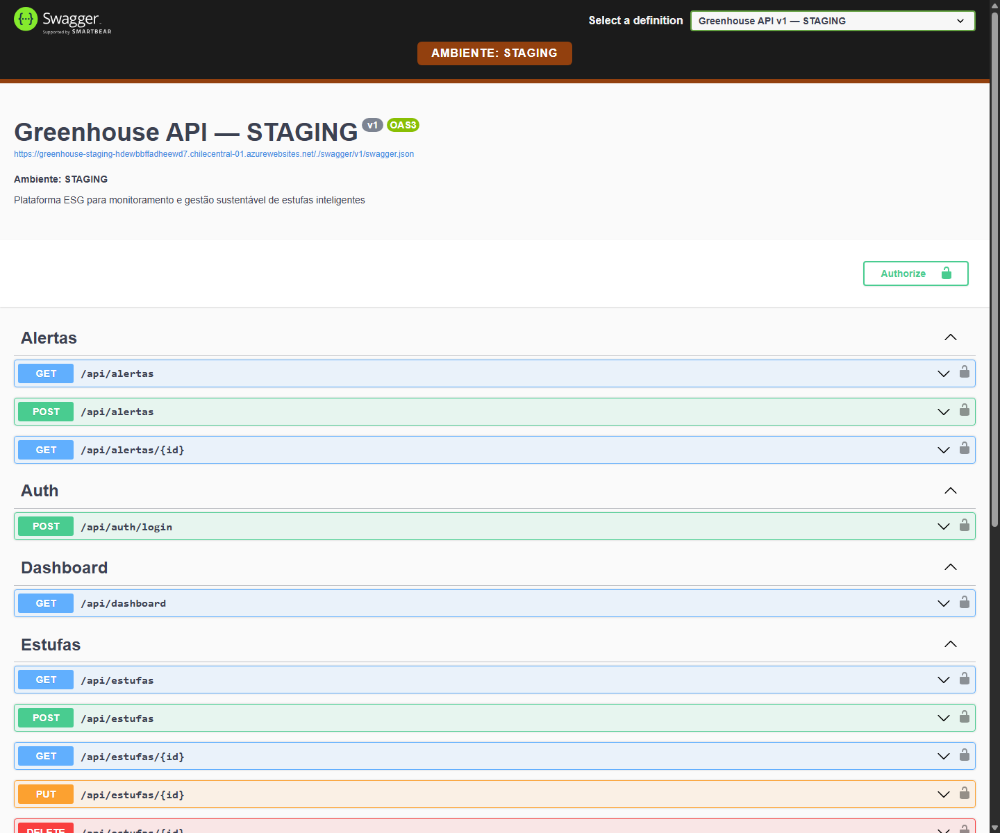
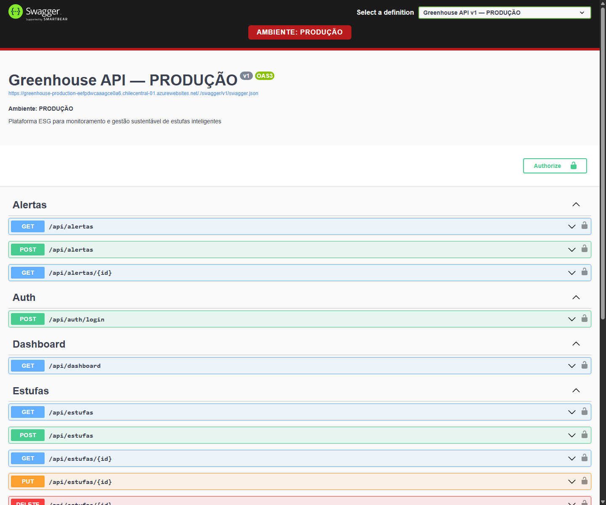
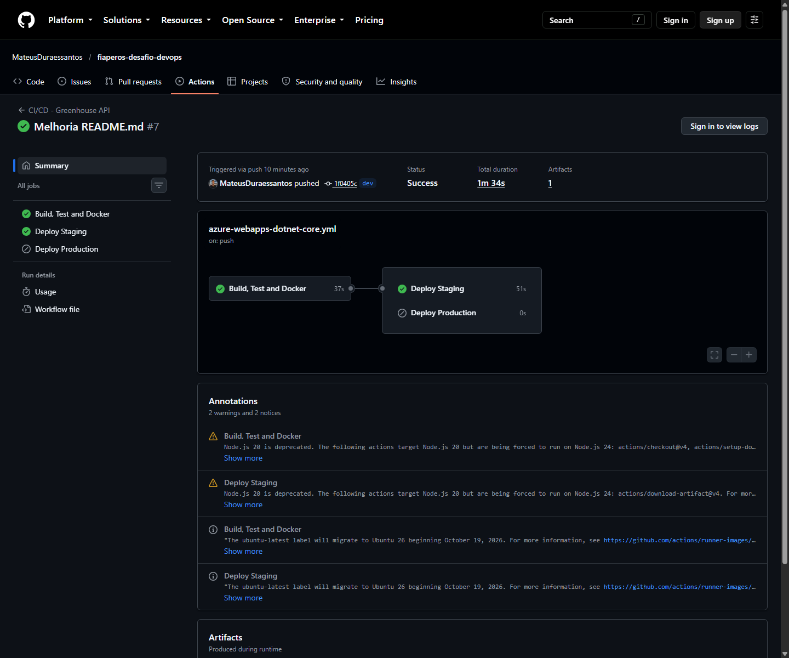
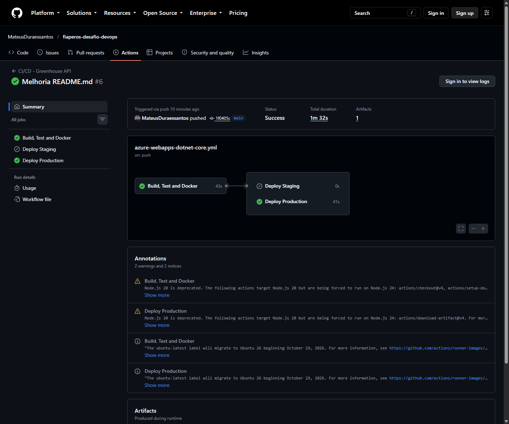

# Evidências da entrega

Capturas reais verificadas em 12/10/2026:

| Arquivo esperado | Conteúdo |
|---|---|
| [pipeline-dev.png](pipeline-dev.png) | Execução anterior concluída em dev: staging aprovado, produção ignorada |
| [pipeline-main.png](pipeline-main.png) | Execução anterior concluída em main: produção aprovada, staging ignorado |
| [staging.png](staging.png) | Swagger publicado com faixa STAGING e hostname no link do documento OpenAPI |
| [producao.png](producao.png) | Swagger publicado com faixa PRODUÇÃO e hostname no link do documento OpenAPI |
| [local.png](local.png) | Pacote atualizado executado diretamente com .NET na porta de validação 18080, sem SQL Server |

Abra as execuções no [GitHub Actions](https://github.com/MateusDuraessantos/fiaperos-desafio-devops/actions). Os resultados dos testes ficam no artefato `test-results` de cada execução.

Links verificados:

- [Staging](https://greenhouse-staging-hdewbbffadheewd7.chilecentral-01.azurewebsites.net/index.html)
- [Produção](https://greenhouse-production-eefpdwcaaagce0a6.chilecentral-01.azurewebsites.net/index.html)
- [Pipeline dev — execução 38305665032](https://github.com/MateusDuraessantos/fiaperos-desafio-devops/actions/runs/38305665032)
- [Pipeline main — execução 38305636147](https://github.com/MateusDuraessantos/fiaperos-desafio-devops/actions/runs/38305636147)

Os prints dos pipelines e ambientes Azure são do commit anterior às correções desta auditoria. Comprovam separação dos deploys e acesso ao Swagger, mas não comprovam execução dos novos testes no GitHub. Atualize os prints após publicar as alterações nas duas branches.

Validações do código atualizado:

- Build e publish Release concluídos com SDK .NET 8.0.425.
- Sete testes aprovados, zero falhas e zero ignorados.
- Sete testes aprovados novamente na pasta extraída do ZIP.
- Página inicial HTTP 200, identificação LOCAL, login com emissão de token e rota protegida retornando 401 sem token.
- ZIP inspecionado sem `.env`, `bin` ou `obj`.

Não foram validados containers ou persistência com SQL Server, pois Docker não está disponível no ambiente da auditoria. A captura local demonstra apenas a interface do pacote publicado e não é evidência de conexão com banco.

Não capture tokens, senhas, publish profiles ou telas de secrets.

## Staging

## Produção

## Pipelines anteriores

